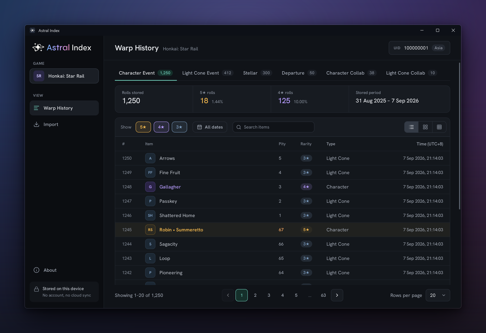
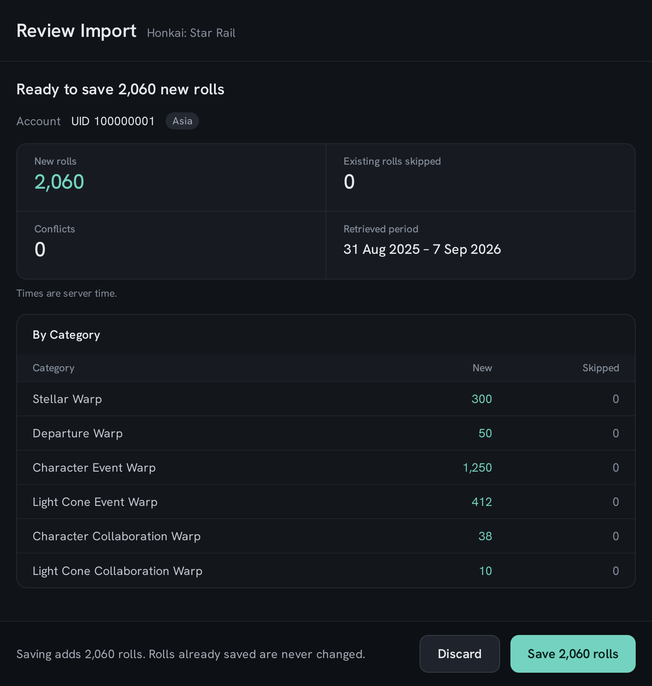
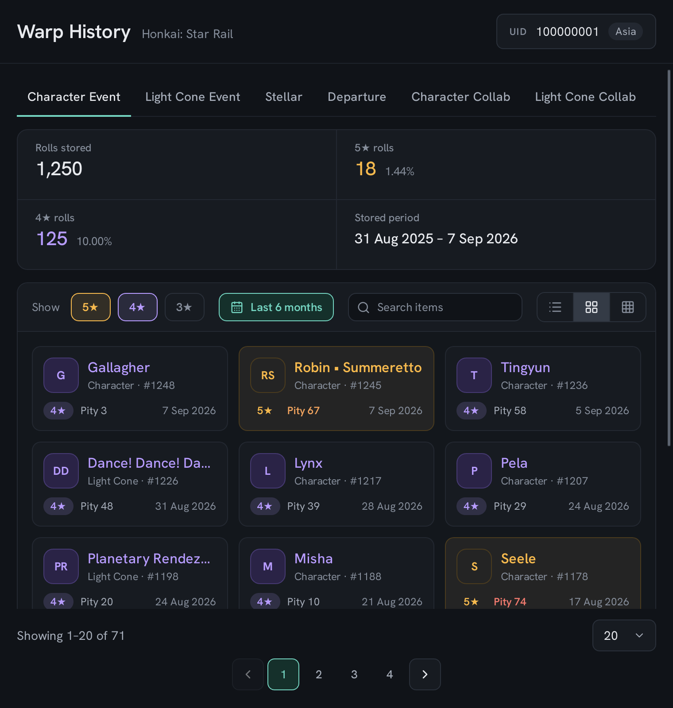

<h1 align="center">
  <picture>
    <source media="(prefers-color-scheme: dark)" srcset="docs/assets/readme/astral-index-logo-dark.svg">
    
  </picture>
</h1>

  Track your gacha roll history on your own machine.

  
  
  
  
  
  
  

  <a href="#download">Download</a> · <a href="#features">Features</a> ·
  <a href="#development">Development</a>

  

## Features

- **Retrieval on request:** Retrieve roll history from HoYoverse on demand;
  either rolls since the last retrieval or the whole available history again.
- **Review before saving:** Preview the count of new rolls, already saved and
  conflicting rolls, and the period covered before saving anything.
- **Saved history:** Browse saved rolls offline by banner category, as a list, a
  grid of tiles or icons. Filter by rarity, item name and date.
- **Roll statistics:** Check your 5★ and 4★ rates and see each 5★ roll's pity.
- **Multi-account support:** Keep history separately per account and server, and
  switch between saved accounts.

<table>
  <tr>
    <td></td>
    <td></td>
  </tr>
  <tr>
    <td align="center">Review before saving</td>
    <td align="center">Saved history, grid view</td>
  </tr>
</table>

## Download

Simply download and run `Astral-Index-<version>.exe` from the
[latest release](https://github.com/shra-ja/astral-index/releases/latest). If you
wish to run in [portable mode](#portable-mode), create a `data` folder next to it
before running it.

## Storage

History is fetched from HoYoverse only on request, and is sent nowhere else. It
is kept in one file, `history.sqlite`, in `%LOCALAPPDATA%\Astral-Index`. The same
folder holds the window's browser cache, `EBWebView`, which holds no history.
The About dialog shows the folder in use.

### Portable mode

If a folder named `data` sits next to the executable, the history and browser
cache are kept there instead, for example `D:\AstralIndex\data\history.sqlite`
beside `D:\AstralIndex\Astral-Index-v1.0.0.exe`. Creating or removing the folder
switches modes on the next start. If both locations hold a history, the portable
one is used and the other is left untouched; to move history across, close the
app and copy `history.sqlite`.

## Development

Astral Index is built with Tauri 2, a Rust backend, a Vue 3 and TypeScript
interface, and SQLite for data storage. Setup instructions, commands and checks
are in [DEVELOPMENT](docs/development/DEVELOPMENT.md), the rules every change
should follow are in [CONTRIBUTING](CONTRIBUTING.md), and the design is described
in [ARCHITECTURE](docs/architecture/ARCHITECTURE.md).

## License

Astral Index is released under the [MIT License](LICENSE). The third-party
components it ships keep their own licences, listed in the app's About dialog.
Astral Index is not affiliated with or endorsed by HoYoverse; game names belong
to their owners.
